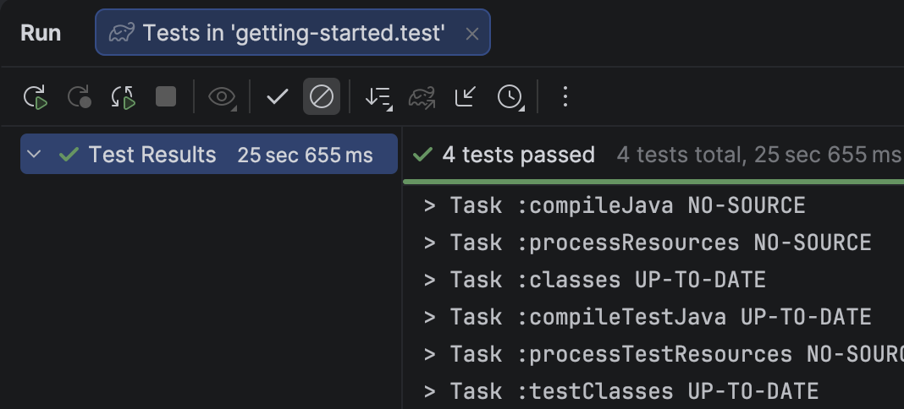

# autotests

Учебные UI-автотесты на Java, написанные в рамках курса **QA.GURU**.

## О проекте

Проект показывает базовую связку для автоматизации тестирования: запуск браузера из кода, работа с элементами страницы и проверка результата.

## Что покрыто тестами

| Класс | Что проверяет |
|-------|---------------|
| `LoginTests` | Вход на school.qa.guru: позитивный и негативный сценарии |
| `SearchTests` | Поиск по GitHub и проверка результатов выдачи |
| `WikiTests` | Переход по вики репозитория Selenide и проверка содержимого страницы |

## Технологии

- **Java 17**
- **Gradle** (сборка и запуск)
- **JUnit 5** (тестовый фреймворк)
- **Selenide** (работа с браузером)

## Требования

- JDK 17
- Google Chrome
- Git

## Как запустить

Клонировать репозиторий:

```bash
git clone git@github.com:savelij-mihalev/autotests.git
cd autotests
```

Запустить все тесты:

```bash
./gradlew test
```

Запустить один класс:

```bash
./gradlew test --tests "LoginTests"
```
## Результат запуска



## Автор

[savelij-mihalev](https://github.com/savelij-mihalev)